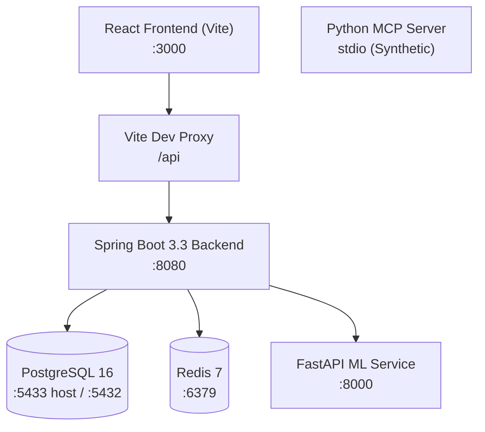

# GlucoTwin AI — Local Development & System Architecture Guide

> **System Overview:** AI-powered Digital Twin platform for Type 2 Diabetes clinical decision support.
> **Date:** October 2026  
> **Status:** Local environment audited, cross-origin/CORS resolved, database ports aligned, all test suites passing.

---

## 1. System Architecture & Component Inventory



| Service | Technology | Port | Role & Capabilities |
| :--- | :--- | :--- | :--- |
| **Frontend** | React 18, Vite 5, Tailwind CSS, TanStack Query, Recharts | `3000` | Clinician dashboard: Patient list, Digital Twin detail, CGM history charts, prediction trigger, What-If simulation, clinical insight review. |
| **Backend** | Java 21, Spring Boot 3.3.0, Gradle, Flyway, Spring AI | `8080` | Core orchestration: REST APIs, JPA persistence, Flyway migrations (V1-V9), simulation calculation, agent-coordinated clinical insights. |
| **ML Service** | Python 3.11, FastAPI, XGBoost 2.0.3, SHAP, Scikit-learn | `8000` | Microservice running trained XGBoost model (`xgboost-v1.0.0`), imputation, feature extraction, spike probabilities, and SHAP risk factors. |
| **Database** | PostgreSQL 16 (Alpine) | `5433` (host)<br/>`5432` (container) | Persistent storage for patients, EHR, twin states, predictions, simulation results, audit logs, and dead letters. |
| **Cache / Queue** | Redis 7 (Alpine) | `6379` | Stream broker for wearable telemetry events and caching. |
| **MCP Server** | Python `mcp` SDK (stdio) | N/A (stdio) | Standalone read-only Model Context Protocol server exposing synthetic tools (`get_patient_twin`, `simulate_glucose_scenario`, etc.). |

---

## 2. Key Architectural Decisions & Safeguards

1. **Strict Data Provenance Isolation:**
   - `OBSERVED`: Patient wearable readings and EHR data.
   - `PREDICTED`: XGBoost probabilistic model outputs based on real twin state.
   - `SIMULATED`: Hypothetical what-if scenarios. Stored in a separate `simulations` table; **never** merged into `glucose_predictions` or real twin states.
2. **Clinical Safety Safeguards:**
   - Every prediction, simulation, and clinical insight response includes a non-negotiable safety disclaimer: *"For research and decision support only. Not a diagnostic system."*
   - LLM Explanation Agent prompt explicitly prohibits medical diagnoses, drug prescription, or fabricating numeric values.
3. **Graceful LLM Degradation:**
   - The backend starts and operates without an `OPENAI_API_KEY`. When AI explanation is disabled or unavailable, the system produces structured deterministic evidence and returns `explanation = null` without failing clinician requests.
4. **Resilient UI & Error Boundaries:**
   - The React application encapsulates routes and the main shell outlet with an `ErrorBoundary`. Uncaught runtime rendering errors or schema discrepancies display a graceful clinical error fallback instead of crashing into an unrecoverable blank screen.

---

## 3. Configuration & Port Mapping

| Parameter | Configuration Key | Local Dev Value | Docker Internal Value |
| :--- | :--- | :--- | :--- |
| **PostgreSQL URL** | `spring.datasource.url` | `jdbc:postgresql://localhost:5433/glucotwin` | `jdbc:postgresql://postgres:5432/glucotwin` |
| **PostgreSQL User / Pass** | `spring.datasource.username` / `password` | `glucotwin` / `glucotwin` | `glucotwin` / `glucotwin` |
| **Redis URL** | `spring.data.redis.url` | `redis://localhost:6379` | `redis://redis:6379` |
| **ML Service URL** | `glucotwin.ml-service.url` | `http://localhost:8000` | `http://ml-service:8000` |
| **ML Auth Token** | `glucotwin.ml-service.internal-token` | `dev-internal-token` | `dev-internal-token` |
| **Frontend API Base** | `VITE_API_BASE_URL` | *(empty — uses Vite proxy `/api`)* | N/A |
| **CORS Allowed Origins** | `glucotwin.security.allowed-origins` | `http://localhost:3000` | `http://localhost:3000` |
| **Dev Auth Header** | `X-Dev-Auth` | `ROLE_CLINICIAN` | `ROLE_CLINICIAN` |
| **AI Explanation Enabled** | `glucotwin.ai.explanation.enabled` | `false` (optional) | `false` |
| **AI Chat Model** | `spring.ai.model.chat` | `none` (or `openai` when key provided) | `none` |
| **Unused OpenAI Auto-Configs** | Audio, Speech, Transcription, Image, Embedding | `none` / excluded | `none` / excluded |

---

## 4. Step-by-Step Local Startup Guide (Windows PowerShell)

> **Startup Sequence:** Infrastructure (PostgreSQL & Redis) ➔ ML Service ➔ Backend ➔ Frontend

### Prerequisites
- **Java:** JDK 21+ (`java -version`)
- **Node.js:** v18+ & npm (`node -v`)
- **Python:** 3.11+ (`python --version`)
- **Docker:** Docker Desktop running (`docker ps`)

---

### Terminal 1: Infrastructure (PostgreSQL & Redis)
From repository root (`GlucoTwin-AI-kiro-project/GlucoTwin-AI-kiro-project`):

```powershell
# 1. Start Docker containers in background
docker compose up -d postgres redis

# 2. Verify PostgreSQL is healthy
docker compose exec postgres pg_isready -U glucotwin

# 3. Seed synthetic demo data (run once on new database)
Get-Content "data\synthetic\seed_patients.sql" | docker compose exec -T postgres psql -U glucotwin glucotwin
Get-Content "data\synthetic\seed_wearable_events.sql" | docker compose exec -T postgres psql -U glucotwin glucotwin
```

---

### Terminal 2: ML Service (FastAPI)
From `ml-service/` directory:

```powershell
Set-Location "ml-service"

# Optional: activate virtual environment
# .\venv\Scripts\Activate.ps1

# Set environment variables
$env:MODEL_DIR = "models/xgboost-v1.0.0"
$env:ML_SERVICE_INTERNAL_TOKEN = "dev-internal-token"

# Run FastAPI server
python -m uvicorn main:app --host 0.0.0.0 --port 8000
```
- Health Check: `http://localhost:8000/health`
- OpenAPI Docs: `http://localhost:8000/docs`

---

### Terminal 3: Backend (Spring Boot)
From `backend/` directory:

```powershell
Set-Location "backend"

# Run Spring Boot (reads default port 5433 from application.yml)
.\gradlew.bat bootRun
```
- Health Check: `http://localhost:8080/api/health`
- Swagger UI: `http://localhost:8080/swagger-ui.html`

---

### Terminal 4: Frontend (Vite + React)
From `frontend/` directory:

```powershell
Set-Location "frontend"

# Start Vite dev server on port 3000
npm run dev
```
- Dashboard: `http://localhost:3000`

---

## 5. Verification & Test Execution

Run the automated test suites across all three components to verify system integrity:

```powershell
# Backend unit & property tests (JUnit 5 + jqwik)
cd backend
.\gradlew.bat test

# Backend clinical evaluation & scenario isolation tests
.\gradlew.bat evaluationTest

# Frontend unit & component tests (Vitest)
cd ..\frontend
npm run test

# Frontend production typecheck & bundle build
npm run build

# Python ML service unit tests (pytest)
cd ..\ml-service
python -m pytest tests/unit -q
```

**Latest Test Results:**
- Backend Unit Tests: **BUILD SUCCESSFUL**
- Backend Evaluation Tests: **BUILD SUCCESSFUL**
- Frontend Unit Tests: **4 passed (74 tests)**
- Frontend Build: **Built successfully in 44.67s (`dist/`)**
- ML Service Unit Tests: **29 passed in 40.68s**

---

## 6. Synthetic Seed Scripts Reference

- **`data/synthetic/seed_patients.sql`:**
  - Creates 5 synthetic patients (`a1000000-0000-0000-0000-000000000001` through `0005`).
  - Populates static EHR profiles (age, sex, BMI, diabetes onset, HbA1c, fasting glucose).
  - Initializes digital twin states to `INITIALISED`.
  - Uses `ON CONFLICT (patient_id) DO NOTHING`.
- **`data/synthetic/seed_wearable_events.sql`:**
  - Ingests 20 wearable event snapshots (4 per patient) across glucose, HR, HRV, sleep stage, and activity.
  - Generates random `event_id` UUIDs; only run once to avoid duplicate history lines.

---

## 7. Known Architectural Notes & Future Roadmap

1. **Redis Stream Consumer Activation:**
   `RedisStreamConfig.java` defines `StreamMessageListenerContainer` but does not currently register `WearableEventConsumer` as a stream listener. Ingested sensor events reach the raw audit table and Redis stream, but asynchronous auto-prediction triggering from the stream is dormant until wired.
2. **Frontend Direct EHR Ingestion:**
   Currently, new patients must be uploaded via `POST /api/v1/patients/{id}/ehr` or seeded via SQL. A future enhancement is adding a "Register Patient" modal in the React dashboard.
3. **MCP Server Integration:**
   The Python MCP server in `mcp-server/glucotwin_mcp_server.py` is currently a self-contained demonstration script with hardcoded patients (`P001`, `P002`). Connecting it directly to PostgreSQL or the Spring Boot API will turn it into a live clinical agent tool.
